<p align="center">
  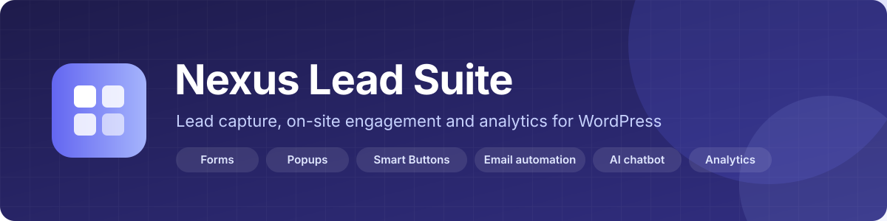
</p>

<p align="center">
  
  
  
  
  
  
</p>

<p align="center">
  <a href="#-quick-start">Quick start</a> ·
  <a href="#-features">Features</a> ·
  <a href="#-integrations-api-setup">API setup</a> ·
  <a href="#-hosting-and-server-setup">Hosting</a> ·
  <a href="#-going-live-checklist">Going live</a> ·
  <a href="#-user-guide">User guide</a> ·
  <a href="#-rest-api">REST API</a> ·
  <a href="#-development">Development</a>
</p>

**Nexus Lead Suite** is an all-in-one lead generation and engagement plugin for WordPress. From one admin hub you build
multi-step forms, popup campaigns, floating smart buttons, automated e-mails and an AI chatbot trained on your own
content, and you follow every click, submission and conversation in a unified activity log with PDF reporting.
The admin is a modern single-page app; the public side ships only lightweight vanilla JavaScript and makes **no outbound
request unless you enable a feature and enter your own keys**.

<p align="center">
  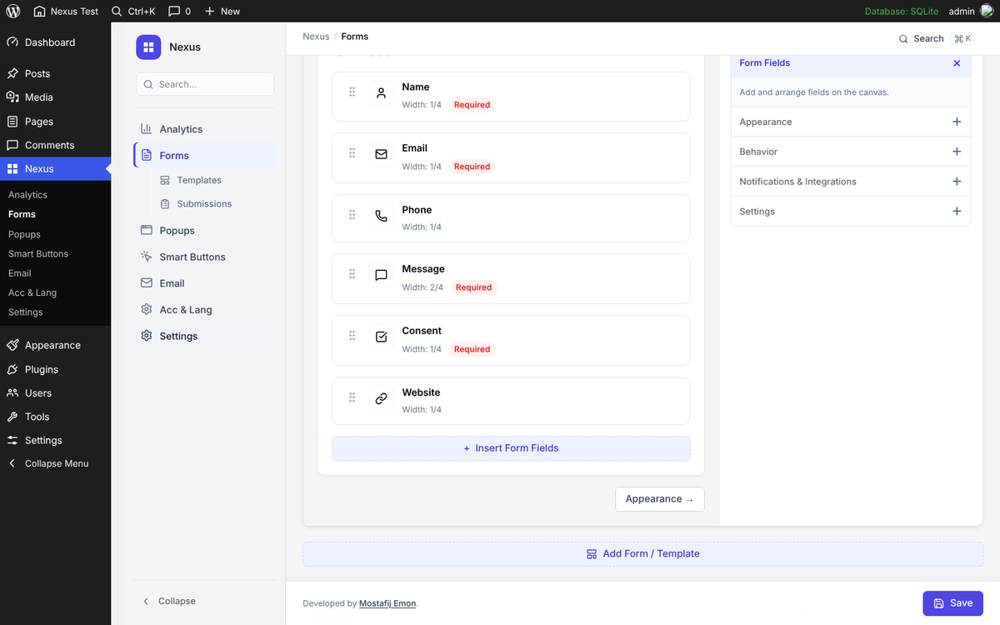
</p>

---

## Contents

- [Why Nexus Lead Suite](#-why-nexus-lead-suite)
- [Features](#-features)
- [Screenshots](#-screenshots)
- [Requirements](#-requirements)
- [Quick start](#-quick-start)
- [Configuration](#-configuration)
- [Integrations (API setup)](#-integrations-api-setup)
- [Hosting and server setup](#-hosting-and-server-setup)
- [Going live checklist](#-going-live-checklist)
- [User guide](#-user-guide)
- [REST API](#-rest-api)
- [Architecture](#-architecture)
- [Security and privacy](#-security-and-privacy)
- [Development](#-development)
- [Troubleshooting](#-troubleshooting)
- [Known limitations](#-known-limitations)
- [License](#-license)

---

## 💡 Why Nexus Lead Suite

| Problem | How Nexus Lead Suite solves it |
| --- | --- |
| A different plugin for forms, popups, chat, e-mail and analytics | **One plugin, one admin hub, one activity log.** Forms, popups, smart buttons, e-mail templates, the AI chatbot and the accessibility dock share the same display conditions and the same reporting. |
| Page builders and form plugins that slow the front end down | The public side loads **plain JavaScript and CSS only where a feature is used**. No front-end framework, no third-party fonts, no CDN images, no telemetry. |
| Chatbots that invent answers | The AI chatbot answers from **your own published posts, pages and products**, stored as embeddings in your database, with FAQ quick replies, lead capture and rate limits. Use any major provider or a self-hosted model. |
| Clients who want to see results without a WordPress login | **Expiring client report links** with per-section permissions (summary counts, submissions, chat transcripts, activity log), plus PDF reports you can e-mail. |
| E-mail that lands in spam or never leaves the host | **SMTP with Google and Microsoft OAuth 2.0** (XOAUTH2), password SMTP, test sends with the full server conversation, and HTML templates with merge tags. |

---

## ✨ Features

### Lead capture
- **Form Builder:** simple and multi-step forms, a 33-type field catalogue (name, e-mail, phone, address, date, file, consent, rating, hidden, page break, layout columns, reCAPTCHA, Turnstile and more), drag-and-drop ordering, conditional logic, confirmation messages or redirects, per-form notification routing, styling presets, import and export, and ready-made templates.
- **Shortcode:** `[nexulesuite_form id="form-1"]` renders any form on any page or in any page builder.
- **Submissions:** every submission is stored for 30 days (adjustable with the `nexulesuite_submission_retention_days` filter), listed with filters and search, exportable to CSV, and forwarded to your **CRM or automation webhook** as JSON.
- **Popups:** heading editor (TinyMCE), body content with shortcodes, triggers (time delay, scroll depth, exit intent, or a manual click from a button class or smart button), display conditions, a device simulator and advanced automation rules.
- **Smart Buttons:** grouped floating action buttons (call, e-mail, open popup, link, notify) with priority, per-group display conditions, colours and a live preview.

### Engagement
- **AI Chatbot:** floating live chat or inline embed (`[nexulesuite_chat]`), a knowledge base trained from your own content, FAQ and quick-reply buttons, lead capture during the conversation (name, e-mail, phone, message), image and document understanding where the model supports it, transcript logs and transcript reports. Works with OpenAI, Anthropic, Google Gemini, Groq, DeepSeek, Mistral, Together AI, OpenRouter, xAI and Voyage AI, or with a **self-hosted Nexus AI Server (FastAPI + Ollama)**.
- **Accessibility & Language dock:** a floating accessibility widget, a Google Website Translator switcher, the live-chat button and a custom button in one stack, with position, offsets, size, order and per-button display conditions.
- **Email automation:** HTML templates with merge tags (`{formName}`, `{btnName}`, `{dateTime}`, `{ipAddress}`, `{pageUrl}` and more), recipient lists, and automatic notifications when tracked elements are clicked or forms are submitted.

### Insight
- **Activities:** a unified timeline of form submissions, calls, consultations and interactions with date and keyword filters, mail status, PDF export, e-mailed reports and a one-click clear.
- **Chatbot reports:** conversations, messages, intents and sentiment with a transcript viewer.
- **Client report links:** tokenised `/report-access/` URLs that expire after a chosen number of days and show only the sections you allow.
- **Visual Editor:** inspect and tune tracked elements directly on the live site from the Activities screen.

### Platform
- **Settings hub:** navigation and footer stack, auto-popup logic with page exclusions, report logo, 23 bundled web fonts served from your own site, and a full-site **export and import** of every setting and record, optionally with embedded media.
- **Clean uninstall:** data stays unless you opt in to removal.
- **Standards:** WordPress coding standards, Plugin Check clean, every admin REST route protected by capability checks and nonces, all output escaped.

---

## 🖼 Screenshots

| | |
| :---: | :---: |
| 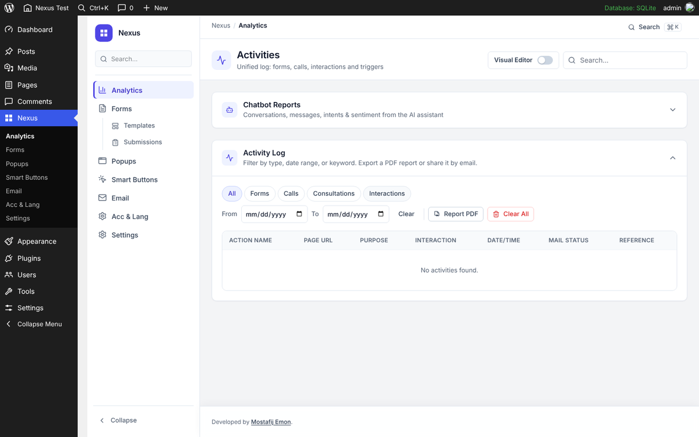<br>**Analytics:** unified activity log, filters, PDF and e-mail reports | 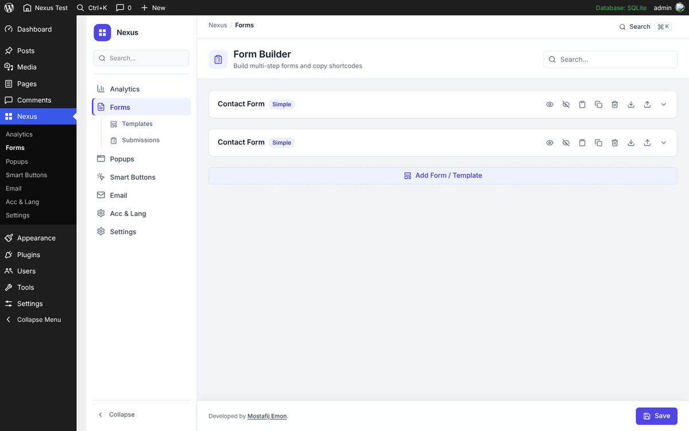<br>**Form Builder:** forms, shortcodes, templates |
| 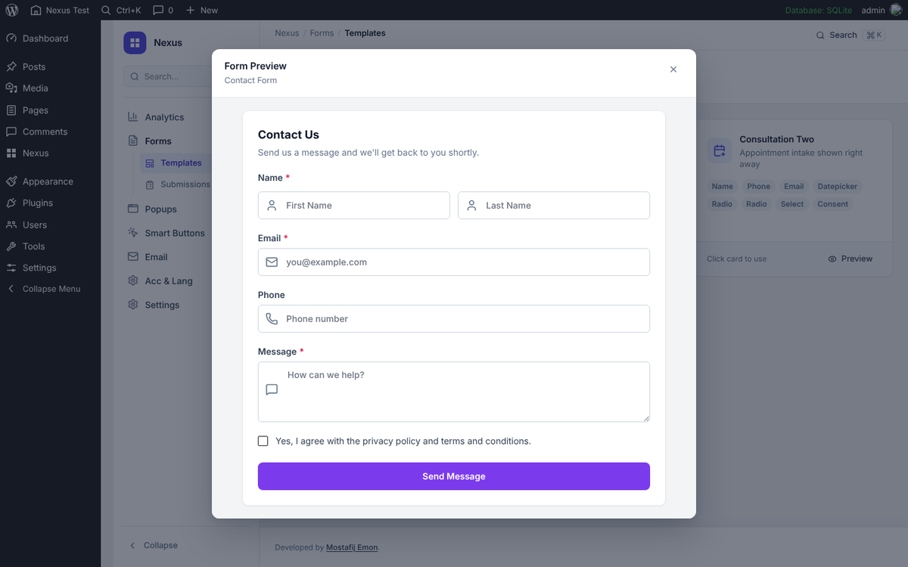<br>**Form preview:** forms rendered exactly as on the site | 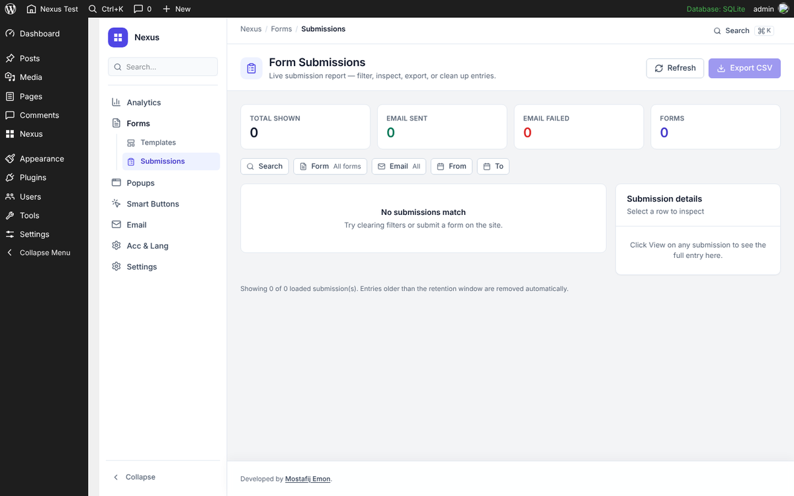<br>**Submissions:** filters, detail pane, CSV export |
| 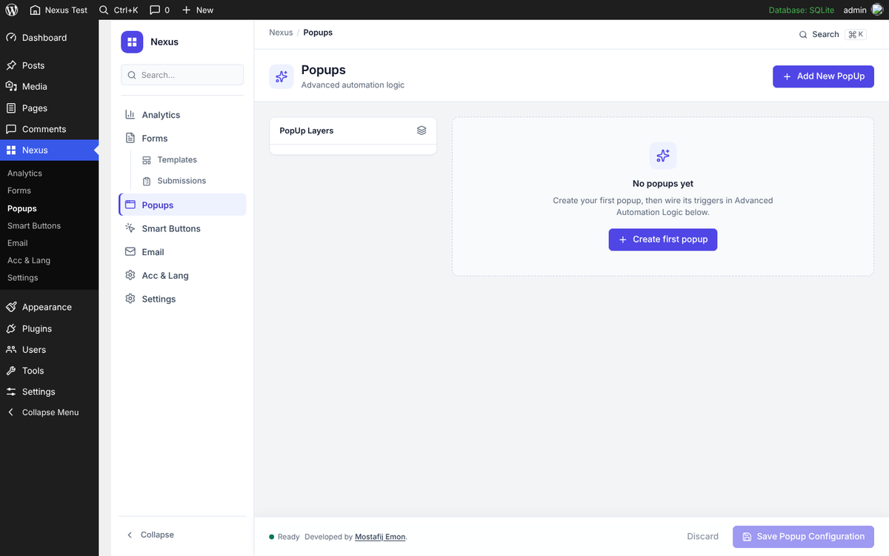<br>**Popups:** triggers, conditions, simulator | 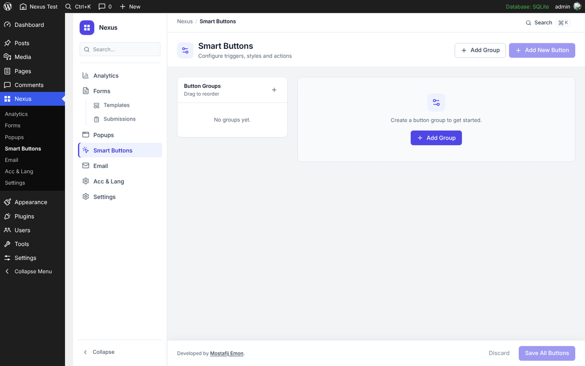<br>**Smart Buttons:** grouped floating actions |
| 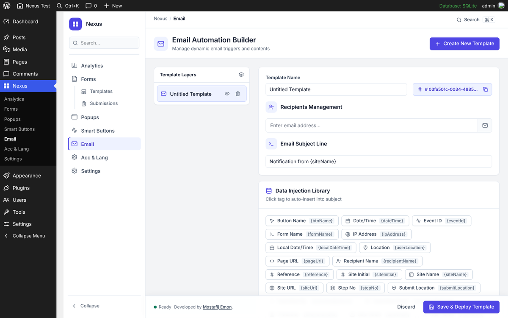<br>**Email automation:** templates, recipients, merge tags | 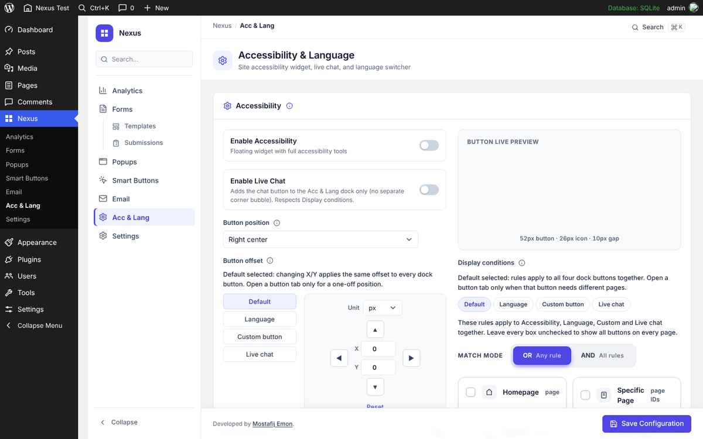<br>**Accessibility & Language:** dock, translator, live chat button |
| 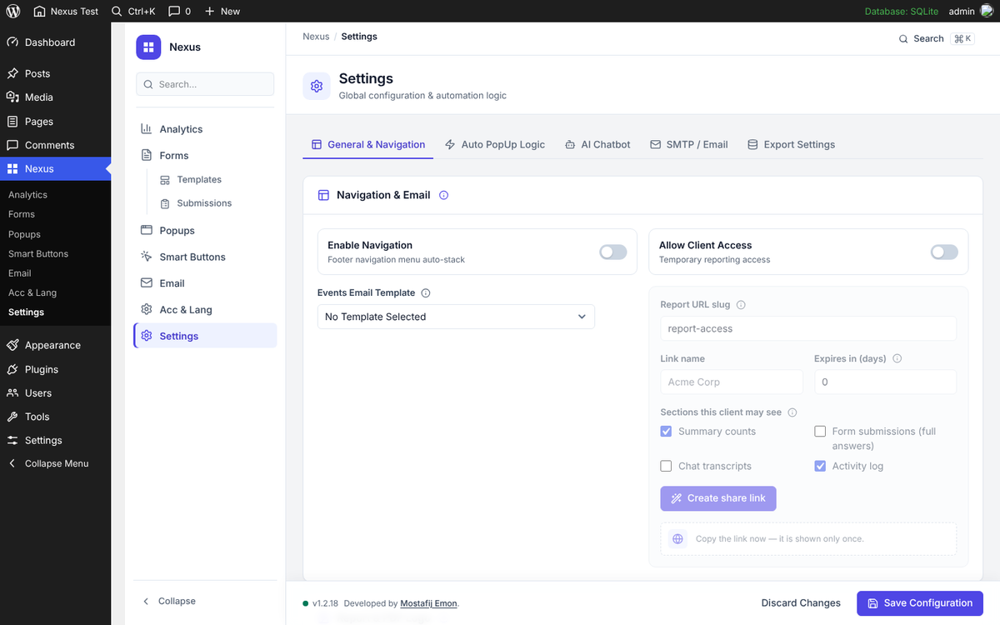<br>**Settings:** general, auto-popup, AI chatbot, SMTP, export | 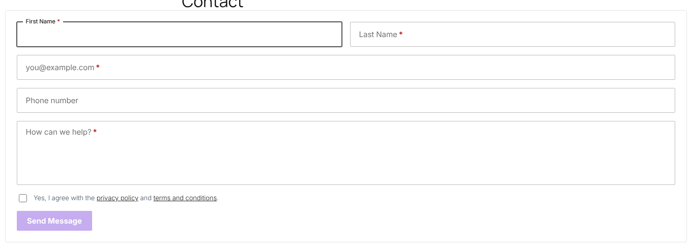<br>**Front end:** a rendered form in a standard theme |

<p align="center">
  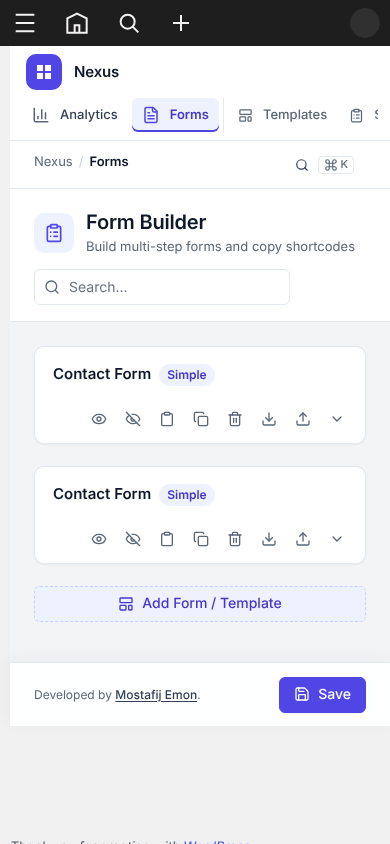
  &nbsp;&nbsp;
  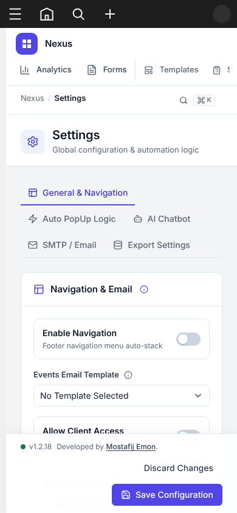
  <br><em>The whole admin is responsive down to phone width and fully keyboard accessible.</em>
</p>

---

## ✅ Requirements

| | Minimum | Recommended |
| --- | --- | --- |
| WordPress | 6.2 | Latest release (tested up to 7.1) |
| PHP | 7.4 | 8.1 or newer |
| Database | MySQL 5.7 / MariaDB 10.3 | MySQL 8 / MariaDB 10.6 |
| PHP extensions | `json`, `mbstring`, `curl`, `openssl` | plus `gd` or `imagick` for image uploads |
| HTTPS | Optional | **Required** for the OAuth mailers and captcha services, and for the chat widget on modern browsers |
| Node.js | — | 20 LTS or newer, only if you rebuild the admin app |

Nothing else is needed. There is no external service, licence server or background daemon; scheduled clean-ups run on WP-Cron.

---

## 🚀 Quick start

### Option A: install the packaged plugin

1. Download the latest release zip from the [Releases](https://github.com/Mostafijemon24/Nexus_Lead_Suite/releases) page.
2. In WordPress go to **Plugins → Add New → Upload Plugin**, choose the zip, click **Install Now**, then **Activate**.
3. Open the new **Nexus** menu in the admin sidebar. Everything works immediately with the built-in defaults.

### Option B: install from this repository

```bash
cd wp-content/plugins
git clone https://github.com/Mostafijemon24/Nexus-Lead-Suite.git nexus-lead-suite
```

The compiled admin assets are committed, so no build step is required. Activate **Nexus Lead Suite** under **Plugins**, or with WP-CLI:

```bash
wp plugin activate nexus-lead-suite
```

### First five minutes

1. **Forms → Templates:** click a template (for example *Contact Form*). It becomes a form and opens in the builder.
2. Copy the shortcode from the form card, for example `[nexulesuite_form id="form-1"]`, and paste it into any page.
3. Submit the form on the site. The entry appears under **Forms → Submissions** and in **Analytics → Activity Log**.
4. **Settings → SMTP / Email:** configure a mailer and click **Send test email** so notifications leave the server reliably.
5. **Email:** create a notification template and select it under **Settings → General → Events Email Template**.

> [!TIP]
> Activation creates four tables (`wp_nexulesuite_interactions`, `wp_nexulesuite_submissions`, `wp_nexulesuite_chat_logs`, `wp_nexulesuite_ai_vectors`), registers the `/report-access/` rewrite rule and schedules the daily clean-up jobs. Nothing is sent anywhere until you configure a service.

---

## ⚙️ Configuration

All configuration lives in **Nexus → Settings** and is stored in WordPress options (prefix `nexulesuite_`). A few values can be forced from `wp-config.php` for managed deployments.

### Settings tabs

| Tab | What you configure |
| --- | --- |
| **General & Navigation** | Footer navigation stack, events e-mail template, client report access (URL slug, link name, expiry, allowed sections), report logo and its size in PDFs, the global font for admin and public surfaces. |
| **Auto PopUp Logic** | Which popup opens automatically, its time, scroll and exit triggers, and the pages or posts to exclude. |
| **AI Chatbot** | Connection mode (direct provider or self-hosted server), provider, API key, chat and embedding models, knowledge-base training and reset, FAQ and quick replies, lead capture, Auto-setup, live chat appearance and embed codes. |
| **SMTP / Email** | Mailer choice (default `mail()`, custom SMTP, Gmail / Google Workspace OAuth, Microsoft 365 / Outlook OAuth), from name and address, test send. |
| **Export Settings** | A full backup of every setting and record as a JSON bundle, optionally with embedded media, and restore from a bundle. |

### `wp-config.php` constants (optional)

| Constant | Purpose |
| --- | --- |
| `nexulesuite_SMTP_ENABLED`, `nexulesuite_SMTP_HOST`, `nexulesuite_SMTP_PORT`, `nexulesuite_SMTP_SECURE`, `nexulesuite_SMTP_USER`, `nexulesuite_SMTP_PASS`, `nexulesuite_SMTP_FROM_EMAIL`, `nexulesuite_SMTP_FROM_NAME` | Force SMTP settings from configuration instead of the database, for fleets of sites or to keep secrets out of the database. |
| `nexulesuite_SMTP_OAUTH_REDIRECT_URI` | Override the OAuth callback URL, for example a public tunnel while developing on a `.local` host. It must still end at `admin-post.php?action=nexulesuite_smtp_oauth_cb`. |
| `nexulesuite_UNINSTALL_DELETE_DATA` | Set to `true` to remove all tables, options and transients when the plugin is deleted. |
| `nexulesuite_VITE_DEV` | Set to `true` to load the admin app from the Vite dev server (`npm run dev`) with hot reload. |

### Filters and scheduled events

| Hook | Use |
| --- | --- |
| `nexulesuite_submission_retention_days` | Change the 30-day submission retention. |
| `nexulesuite_smtp_oauth_redirect_uri` | Change the OAuth callback URL programmatically. |
| `nexulesuite_purge_form_submissions`, `nexulesuite_purge_report_pdfs` | Daily WP-Cron events that remove expired submissions and generated PDF files. |

---

## 🔌 Integrations (API setup)

Every integration is **off by default** and is contacted only after you enter your own credentials. The full list of
services, endpoints and the data sent to each one is documented in [`readme.txt`](readme.txt) under *External services*.

<details open>
<summary><strong>AI chatbot: direct provider (OpenAI, Anthropic, Gemini, Groq, DeepSeek, Mistral, Together AI, OpenRouter, xAI, Voyage AI)</strong></summary>

1. Create an API key in the provider's console. The Settings page links to each one (for example *platform.openai.com → API keys*).
2. Open **Nexus → Settings → AI Chatbot → Setup**, set *Connection mode* to **Direct**, choose the provider and paste the key. The key is encrypted at rest and never sent back to the browser; the page only shows that a key is saved.
3. Pick a **chat model** and, for the knowledge base, an **embedding model**. Providers without embeddings (for example Groq or xAI) can be paired with Voyage AI or OpenAI for embeddings only.
4. Click **Test connection**, then **Train** to index your published posts, pages and products into `wp_nexulesuite_ai_vectors`. Run *Train* again after large content changes; *Clear* empties the index.
5. Add **FAQ** answers and **quick-reply buttons**, turn on **lead capture** if the bot should collect contact details, and save.
6. Show the widget: turn on **Acc & Lang → Enable Live Chat** for the floating button, or place `[nexulesuite_chat]` on a page (see [Shortcodes](#shortcodes)).

Each chat request sends the visitor's message, recent turns, your system prompt and the matching excerpts of your content to the chosen provider only. Visitors are rate-limited per IP address.
</details>

<details>
<summary><strong>AI chatbot: self-hosted Nexus AI Server (FastAPI + Ollama)</strong></summary>

Use this when data must not leave your infrastructure. The plugin talks to a small REST service you host; the service runs the model with Ollama.

1. Provision a server with Ollama installed and pull the models you want:
   ```bash
   ollama pull qwen3:8b
   ollama pull nomic-embed-text
   ```
   A GPU is strongly recommended for chat latency; embeddings run fine on a CPU.
2. Run the Nexus AI Server (FastAPI) in front of Ollama and expose it over HTTPS. The plugin calls these routes on the base URL you enter, with `Authorization: Bearer <key>`: `GET /health`, `POST /provider/test`, `POST /ingest`, `POST /reset`, `POST /chat`, `POST /analyze`.
3. In **Settings → AI Chatbot → Setup**, set *Connection mode* to **Server**, enter the **Server URL** and the **API key** you configured on the server, choose *Ollama* with the chat model (`qwen3:8b` or `llama3.1:8b`) and the embedding model (`nomic-embed-text`), then **Test connection** and **Train**.

In server mode the plugin sends the same data as in direct mode, but only to the base URL you entered.
</details>

<details>
<summary><strong>Gmail / Google Workspace SMTP (OAuth 2.0)</strong></summary>

1. In [Google Cloud Console](https://console.cloud.google.com) create a project, enable the **Gmail API**, and configure the **OAuth consent screen** (External, scope `https://mail.google.com/`). Add your own account as a test user while the app is in testing.
2. Under **Credentials → Create credentials → OAuth client ID**, choose *Web application* and add this **Authorized redirect URI** (with your domain):
   ```
   https://example.com/wp-admin/admin-post.php?action=nexulesuite_smtp_oauth_cb
   ```
   The exact URL is shown on the SMTP tab as *Authorized Redirect URI*; copy it from there.
3. In **Nexus → Settings → SMTP / Email**, choose **Gmail**, paste the Client ID and Client Secret, save, click **Authorize** and approve access with the mailbox that should send e-mail. The From address is pinned to that account.
4. Click **Send test email**. The response shows the full SMTP conversation if anything fails.

The Gmail preset uses port 587 with STARTTLS because many hosts block 465. Client secrets and refresh tokens are stored encrypted.
</details>

<details>
<summary><strong>Microsoft 365 / Outlook SMTP (OAuth 2.0)</strong></summary>

1. In the [Azure portal](https://portal.azure.com) open **Microsoft Entra ID → App registrations → New registration**. Supported account types: *Accounts in any organizational directory and personal Microsoft accounts*. Redirect URI (Web): the same `admin-post.php?action=nexulesuite_smtp_oauth_cb` URL shown on the SMTP tab.
2. Under **Certificates & secrets** create a client secret. Under **API permissions** add the delegated permissions `SMTP.Send` (Office 365 Exchange Online) and `offline_access`.
3. Make sure **Authenticated SMTP** is enabled for the mailbox in the Microsoft 365 admin center.
4. In **Settings → SMTP / Email**, choose **Outlook**, enter the Application (client) ID and the secret, save, **Authorize**, then **Send test email**.
</details>

<details>
<summary><strong>Any SMTP server (Amazon SES, Brevo, Mailgun, Postmark, SendGrid, your host)</strong></summary>

Choose **Other SMTP** and enter host, port, encryption (`TLS` for 587, `SSL` for 465), username, password, and the From name and address. Typical values:

| Provider | Host | Port |
| --- | --- | --- |
| Amazon SES | `email-smtp.<region>.amazonaws.com` | 587 |
| Brevo | `smtp-relay.brevo.com` | 587 |
| Mailgun | `smtp.mailgun.org` | 587 |
| Postmark | `smtp.postmarkapp.com` | 587 |
| SendGrid | `smtp.sendgrid.net` | 587 |

Publish SPF and DKIM records for the From domain at your DNS provider so notifications are not marked as spam.
</details>

<details>
<summary><strong>Google reCAPTCHA</strong></summary>

1. Register the site at [google.com/recaptcha/admin](https://www.google.com/recaptcha/admin) and copy the **site key** and **secret key**.
2. In the Form Builder open the form, click **Insert Form Fields** and add the **reCAPTCHA** field. Enter the keys in the field's settings; they are saved once for all forms.
3. The widget loads only on pages where a protected form is rendered; tokens are verified server-side on every submission.
</details>

<details>
<summary><strong>Cloudflare Turnstile</strong></summary>

1. In the Cloudflare dashboard open **Turnstile → Add site**, add your hostname and copy the **site key** and **secret key**.
2. In the Form Builder add the **Turnstile** field from **Insert Form Fields** and enter the keys in its settings.
</details>

<details>
<summary><strong>CRM or automation webhook (Zapier, Make, n8n, HubSpot, your own endpoint)</strong></summary>

Open the form's **Notifications & Integrations** tab and enter the **webhook URL**. Every accepted submission is POSTed to it as JSON with the form name, field values, page URL, timestamp and visitor metadata. A site-wide URL for all forms can be set through the `submissionWebhookUrl` field of the `settings/general` REST route.
</details>

<details>
<summary><strong>Google Website Translator</strong></summary>

Turn on the language switcher in **Acc & Lang → Language** and choose the languages. The visitor's browser loads Google's translator widget only while this setting is on; flags are local Unicode emoji, so no images are fetched from third parties.
</details>

---

## ☁️ Hosting and server setup

Nexus Lead Suite is a standard WordPress plugin: any host that runs WordPress 6.2 and PHP 7.4 can run it. Below is a
production-grade setup on a fresh Ubuntu 22.04 / 24.04 server. Managed WordPress hosts (Kinsta, WP Engine, SiteGround,
Cloudways, Hostinger and similar) need only steps 5 to 8.

### 1. Install the stack (Nginx, PHP-FPM, MariaDB)

```bash
sudo apt update && sudo apt install -y nginx mariadb-server \
  php8.2-fpm php8.2-mysql php8.2-curl php8.2-gd php8.2-mbstring php8.2-xml php8.2-zip php8.2-intl php8.2-imagick
sudo mysql_secure_installation
sudo mysql -e "CREATE DATABASE wordpress CHARACTER SET utf8mb4 COLLATE utf8mb4_unicode_ci;
CREATE USER 'wp'@'localhost' IDENTIFIED BY 'strong-password';
GRANT ALL ON wordpress.* TO 'wp'@'localhost'; FLUSH PRIVILEGES;"
```

### 2. Install WordPress with WP-CLI

```bash
curl -O https://raw.githubusercontent.com/wp-cli/builds/gh-pages/phar/wp-cli.phar
chmod +x wp-cli.phar && sudo mv wp-cli.phar /usr/local/bin/wp
sudo mkdir -p /var/www/example.com && sudo chown -R www-data:www-data /var/www/example.com
cd /var/www/example.com
sudo -u www-data wp core download
sudo -u www-data wp config create --dbname=wordpress --dbuser=wp --dbpass='strong-password'
sudo -u www-data wp core install --url=https://example.com --title="Example" \
  --admin_user=admin --admin_email=you@example.com --admin_password='choose-a-strong-password'
```

### 3. Nginx server block

`/etc/nginx/sites-available/example.com`:

```nginx
server {
    listen 80;
    server_name example.com www.example.com;
    root /var/www/example.com;
    index index.php;
    client_max_body_size 64m;          # settings bundle import, logo and chat avatar uploads

    location / { try_files $uri $uri/ /index.php?$args; }
    location ~ \.php$ {
        include snippets/fastcgi-php.conf;
        fastcgi_pass unix:/run/php/php8.2-fpm.sock;
        fastcgi_read_timeout 120s;     # AI training and provider calls
    }
    location ~* \.(woff2|css|js|png|jpg|svg)$ { expires 30d; add_header Cache-Control "public"; }
}
```

```bash
sudo ln -s /etc/nginx/sites-available/example.com /etc/nginx/sites-enabled/
sudo nginx -t && sudo systemctl reload nginx
```

<details>
<summary>Prefer Apache?</summary>

Install `apache2 libapache2-mod-php8.2`, enable `mod_rewrite`, point a virtual host at `/var/www/example.com` with `AllowOverride All`, and raise `upload_max_filesize` and `post_max_size` to 64M in `php.ini`. WordPress writes the required `.htaccess` rules itself.
</details>

### 4. HTTPS with Let's Encrypt

```bash
sudo apt install -y certbot python3-certbot-nginx
sudo certbot --nginx -d example.com -d www.example.com
```

HTTPS is required for the OAuth mailers and captcha services, and browsers need it for the chat widget's features.

### 5. PHP settings worth checking

| Setting | Value | Why |
| --- | --- | --- |
| `upload_max_filesize`, `post_max_size` | `64M` | Settings bundle import with embedded media |
| `max_execution_time` | `120` | Knowledge-base training on large sites |
| `memory_limit` | `256M` | PDF report generation with the bundled fonts |
| `allow_url_fopen` or cURL | enabled | Provider and OAuth calls go through the WordPress HTTP API |

### 6. Install and activate the plugin

```bash
cd /var/www/example.com/wp-content/plugins
sudo -u www-data git clone https://github.com/Mostafijemon24/Nexus-Lead-Suite.git nexus-lead-suite
sudo -u www-data wp plugin activate nexus-lead-suite
sudo -u www-data wp rewrite flush      # registers the /report-access/ client link route
```

### 7. Reliable scheduled jobs (recommended)

WP-Cron runs on page views. On a production server replace it with a system cron so the daily clean-ups run on time:

```bash
sudo -u www-data wp config set DISABLE_WP_CRON true --raw
echo "*/5 * * * * www-data cd /var/www/example.com && /usr/local/bin/wp cron event run --due-now >/dev/null 2>&1" | sudo tee /etc/cron.d/wordpress
```

### 8. Backups

Back up the database and `wp-content/uploads` with your host's tools or a backup plugin. In addition, **Settings → Export Settings** produces a single JSON bundle with every Nexus Lead Suite setting and record that can be restored on another site.

### Updating

```bash
cd /var/www/example.com/wp-content/plugins/nexus-lead-suite
sudo -u www-data git pull
```

Database schema upgrades run automatically on the next admin page load. If you installed from a release zip, upload the new zip through **Plugins → Add New → Upload Plugin**; WordPress offers *Replace current with uploaded*.

---

## ✅ Going live checklist

- [ ] Site served over **HTTPS**; permalinks set to anything but *Plain*
- [ ] **SMTP** configured and *Send test email* succeeded; SPF and DKIM published for the From domain
- [ ] **Events Email Template** selected and at least one recipient saved
- [ ] First form published with the shortcode; a real test submission shows in *Submissions* and arrived by e-mail
- [ ] Spam protection (reCAPTCHA or Turnstile) field added with keys, and a submission verified
- [ ] Popups and smart buttons checked on desktop and phone with the device simulator and on the live site
- [ ] AI chatbot: provider key or server URL set, *Test connection* green, *Train* completed, FAQ reviewed, a real conversation tested, lead capture verified
- [ ] Accessibility dock position and display conditions reviewed on a few page types
- [ ] Client report link created, opened in a private window, and the allowed sections confirmed
- [ ] System cron configured (step 7 above) and a backup taken, including a Settings export bundle
- [ ] Privacy policy updated for the services you enabled (see *External services* in `readme.txt`)

---

## 📘 User guide

The admin lives under the **Nexus** menu. Each screen has a sticky footer with **Discard** and **Save**; nothing is written until you save.

### Analytics
The activity log lists every tracked event: form submissions, phone and e-mail clicks, consultations, popup triggers and smart-button clicks. Filter by type, date range or keyword, export the current view as **PDF**, e-mail it, or clear the log. **Chatbot Reports** lists conversations with intent and sentiment and opens full transcripts. **Visual Editor** switches on an on-site inspector so you can see which elements are tracked and adjust button classes (the `popup:`, `mail:` and `notify:` prefixes) without touching the theme.

### Forms
- **Form Builder:** each form is a card with its name, shortcode and actions (preview, duplicate, export, import, delete). Expand a card to open the canvas, add fields from **Insert Form Fields**, drag to reorder, and edit a field's label, placeholder, width, validation, options and conditional logic in the side panel.
- **Tabs per form:** *Fields*, *Appearance* (colours, fonts, style, presets), *Behavior* (submit action, success message, redirect), *Notifications & Integrations* (templates, recipients, routing rules, webhook), *Settings*. Multi-step forms add *Steps*, *Confirmations* and *Advanced*.
- **Templates:** click a tile to create a form from it; **Preview** shows it exactly as visitors will see it.
- **Submissions:** stat tiles, filters by form, e-mail status and date, a detail pane per entry, **Export CSV**, delete.

### Popups
Create a popup, write the heading and body, choose a trigger (delay, scroll, exit intent, or manual: a button class or smart button that targets the popup's event id), set display conditions (all pages, specific pages or posts, post types, slugs, URL patterns), style it and check it in the simulator. **Settings → Auto PopUp Logic** decides which popup opens automatically and where it must not.

### Smart Buttons
Create a **group**, set its display conditions and position, then add **buttons** with an action (call, e-mail, open popup, link, notify), a label, an icon and colours. Order buttons by priority and preview the stack live. Groups without conditions show on every page.

### Email
Templates are HTML with inline styling. Use the **Data injection library** to insert merge tags, manage **recipients**, set the subject, and edit the raw **HTML source** when needed. Script and style blocks are stripped on save for safety. **Save & Deploy** makes the template available in form notifications and in the events template setting.

### Acc & Lang
Enable the accessibility widget, the language switcher, the live-chat button and a custom button; set the dock position, offsets (X and Y per button or for all), size, icon size, gap and order; give each button its own display conditions and watch the live preview.

### Settings
See [Configuration](#-configuration). The **Export Settings** tab creates a complete backup bundle and restores one.

### Client report links
**Settings → General → Allow Client Access:** choose the URL slug (default `report-access`), a link name, the expiry in days and the sections the client may see, then **Create share link**. The link is shown once. Revoke links from the table at any time.

### Shortcodes

| Shortcode | Attributes | Notes |
| --- | --- | --- |
| `[nexulesuite_form id="form-1"]` | `id` (required) | Renders the form with its own styling. |
| `[nexulesuite_chat]` | `mode` (`inline`), `height` (`680`), `width` (`100%`), `max_width` (`none`), `full_width` (`yes`/`no`), `hide_floating` (`yes`/`no`) | Embeds the chatbot inline. Requires **Enable Live Chat** in Acc & Lang; otherwise only administrators see a notice. |

The **AI Chatbot → Live chat** tab also provides a ready-made `<iframe>` embed code for sites outside WordPress.

---

## 🔗 REST API

Namespace: `/wp-json/nexulesuite_/v1/`. Admin routes require the `manage_options` capability and a REST nonce in the `X-WP-Nonce` header, which is how the admin app calls them. Three routes are public for the front-end widgets; they carry their own nonces and are rate-limited per IP.

| Area | Routes |
| --- | --- |
| Forms | `GET/POST /forms`, `GET/POST /forms/global-appearance`, `GET /form-submissions`, `POST /form-submissions/delete`, `POST /render-shortcode` |
| Captcha | `GET/POST /captcha/recaptcha`, `GET/POST /captcha/turnstile` |
| Popups and buttons | `GET/POST /popups`, `GET/POST /menu-items`, `GET /menu-items/condition-meta`, `GET /menu-items/content-search` |
| E-mail | `GET/POST /emails/templates`, `GET/POST /smtp/settings`, `POST /smtp/test`, `POST /smtp/oauth/start`, `POST /smtp/oauth/disconnect` |
| Settings | `GET/POST /settings/general`, `GET/POST /settings/accessibility-language`, `POST /settings/upload-chat-image`, `POST /settings/upload-report-logo`, `GET/POST /settings/client-links`, `DELETE /settings/client-links/{id}`, `GET /settings/full-export`, `POST /settings/full-import` |
| Reports | `GET /reports/activities/list`, `POST /reports/activities/pdf`, `POST /reports/activities/email`, `POST /reports/activities/clear`, `POST /reports/combined/pdf`, `POST /visual-editor/toggle`, `POST /visual-editor/update` |
| AI | `POST /ai/test`, `POST /ai/train`, `POST /ai/reset`, `GET/POST /ai/faq`, `POST /ai/autogen`, `POST /ai/autogen/apply`, `GET /ai/logs`, `GET /ai/logs/detail`, `POST /ai/logs/clear` |
| Public (no login) | `POST /ai/chat`, `POST /ai/lead`, `POST /track/events` |

Report routes also accept a valid client report token, which is how the `/report-access/` page reads its data.

Front-end forms submit through `admin-ajax.php` (`nexulesuite_submit_form`), and tracked clicks use `nexulesuite_trigger_notify` and `POST /track/events`; all of them are nonce-protected and sanitised server-side.

---

## 🏗 Architecture

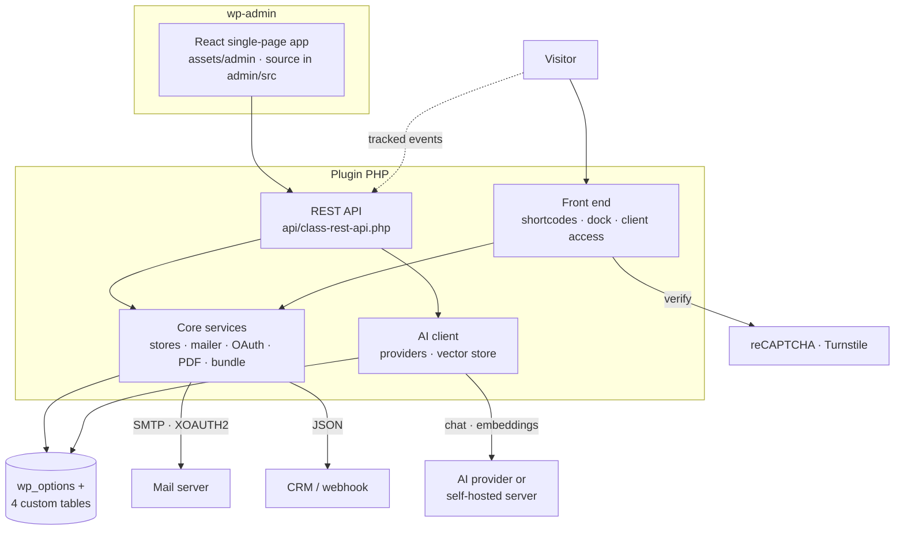

```
nexus-lead-suite.php     plugin bootstrap and constants
core/                    plugin lifecycle, stores (activities, submissions, chat, vectors), mailer, SMTP OAuth,
                         PDF writer and fonts, data bundle export/import, global font, payload codecs
api/class-rest-api.php   all REST routes, permission callbacks, sanitisation
ai/                      provider catalogue and LLM client, prompts, file/PDF text extraction
public/                  shortcodes, forms runtime, popup bridge, tracker, visual editor, accessibility dock,
                         client report gateway (vanilla JS + CSS)
admin/                   admin app loader (PHP) and the React/Vite source of the admin bundle
assets/admin/            compiled admin bundle, fonts and integration CSS
languages/               translation template
docs/                    screenshots, banner, engineering notes
```

**Admin design system.** The admin app uses one set of design tokens (`admin/src/styles/tokens.css`) and a shared component library (`components.css`): consistent spacing, typography, one primary colour, semantic states, accessible dialogs (focus trap, Escape, focus return), landmarks and labelled controls. The same layout works from 1440 px desktops to 390 px phones.

---

## 🔒 Security and privacy

- Every admin REST route checks `manage_options` and a REST nonce; public routes verify their own nonces, are rate-limited by IP and accept only sanitised payloads.
- Form submissions are sanitised field by field and all output is escaped with form-aware `wp_kses` allow-lists. E-mail templates cannot contain `<script>` or `<style>`.
- AI API keys, OAuth client secrets and refresh tokens are encrypted at rest and are never returned to the browser.
- The OAuth `state` value is a single-use token, and the callback also checks the capability of the user who started the flow.
- Client report links are random tokens checked against their granted sections on every request and expire automatically.
- Uploads go to a plugin-owned folder through `WP_Filesystem` and accept only file types WordPress allows.
- No telemetry, no calls to the author's servers, no third-party fonts or images: the 23 web fonts and all icons ship inside the plugin.
- Uninstall keeps your data unless you set `nexulesuite_erase_on_uninstall` to `1` or define `nexulesuite_UNINSTALL_DELETE_DATA`.

---

## 🧑‍💻 Development

The admin app is React 18 + Vite 6 + Tailwind (layout utilities only) and is committed as a compiled bundle, so contributors who only change PHP never need Node.

### Rebuild the admin bundle

```bash
cd admin
npm ci
npm run build        # writes assets/admin/js/main.js, css/main.css and vite-manifest.json
```

### Hot reload while developing

```bash
cd admin && npm run dev
```

and add to `wp-config.php`:

```php
define( 'nexulesuite_VITE_DEV', true );
```

### Project conventions

| Item | Value |
| --- | --- |
| Plugin slug / text domain | `nexus-lead-suite` |
| Prefixes | `nexulesuite_` for the PHP namespace, functions, hooks, options, REST namespace, CSS classes and JS globals |
| Admin menu slugs | `nexus-lead-suite` (Forms), `-analytics`, `-templates`, `-submissions`, `-popups`, `-menus`, `-emails`, `-accessibility`, `-settings` |
| Coding standard | WordPress Coding Standards; `php -l` and Plugin Check clean |
| Admin source layout | `admin/src/shell` (router), `admin/src/shared` (navigation, primitives, display conditions), `admin/src/pages` (one module per screen), `admin/src/styles` (tokens, base, components, pages) |

### Engineering notes

- [`REDESIGN-FUNCTIONALITY-MAP.md`](REDESIGN-FUNCTIONALITY-MAP.md): every screen, control, route, option and table the admin depends on.
- [`REDESIGN-CHANGELOG.md`](REDESIGN-CHANGELOG.md), [`REDESIGN-TEST-REPORT.md`](REDESIGN-TEST-REPORT.md), [`REDESIGN-RELEASE-CHECKLIST.md`](REDESIGN-RELEASE-CHECKLIST.md): what changed in the admin redesign, how it was verified, and what to do before a release.
- [`docs/redesign-audit/`](docs/redesign-audit/): UI inventory, backend contract map and CSS/front-end map.

### Packaging a release

Zip the plugin folder **without** `.git`, `admin/node_modules`, `docs/`, `README.md` and the `REDESIGN-*.md` files. Keep `admin/src` and the build configuration: WordPress.org requires the human-readable source of the compiled bundle inside the package.

---

## 🩺 Troubleshooting

| Symptom | Fix |
| --- | --- |
| The **Nexus** admin pages are blank | Another plugin or a security rule is blocking `/wp-json/`. Open `https://example.com/wp-json/nexulesuite_/v1/settings/general` while logged in; it must return JSON, not HTML. Also check that permalinks are not set to *Plain*. |
| "The link you followed has expired" during OAuth | The callback URL in Google or Azure does not match the *Authorized Redirect URI* shown on the SMTP tab. Copy it exactly, including `?action=…`. |
| OAuth connects but the test e-mail says "Could not authenticate" | For Gmail, the Gmail API must be enabled and the authorising account must be a test user or the app published. For Microsoft, enable *Authenticated SMTP* for the mailbox. |
| "Could not connect to SMTP host" | The host's firewall blocks the port. Try 587 with TLS; many hosts block 465. |
| The form shows but submitting does nothing | A caching or optimisation plugin deferred `forms-runtime.js`. Exclude `nexus-lead-suite` scripts from deferral and combination. |
| Captcha fails on every submission | Site key and secret key are swapped, or the domain is not registered in the captcha console. |
| AI "Test connection" fails | Check the key, the model name and outbound HTTPS from the server (`wp eval 'var_dump(wp_remote_get("https://api.openai.com"));'`). In server mode, `GET /health` on the server URL must return 200. |
| Training stops early | Raise `max_execution_time` and `memory_limit` (hosting step 5) and run *Train* again. |
| `/report-access/` returns 404 | Save permalinks once (**Settings → Permalinks → Save**) or run `wp rewrite flush`. |
| PDF report has missing characters | The bundled fonts cover Latin text; the global font setting controls the PDF typeface. |
| Admin app looks unstyled after an update | Clear the page cache and any CDN cache for `wp-content/plugins/nexus-lead-suite/assets/admin/`. |

---

## ⚠️ Known limitations

- AI providers, OAuth mailers and captcha services are external accounts you must create yourself; their pricing and approval processes apply.
- Submissions are kept for 30 days by default (change it with the retention filter); long-term storage belongs in your CRM via the webhook.
- The Google translator widget is a client-side service and works only while the switcher is enabled.
- Multisite is supported for installation and uninstall, but settings are per site.

---

## 📄 License

Nexus Lead Suite is free software released under the **GNU General Public License, version 2 or later** (see the plugin header and the [LICENSE](LICENSE) file). Bundled web fonts are licensed under the SIL Open Font License 1.1.

Copyright © 2026 Mostafij Emon.

<p align="center"><sub>Built for agencies and site owners who want leads, engagement and answers from one WordPress plugin, without slowing the site down.</sub></p>
